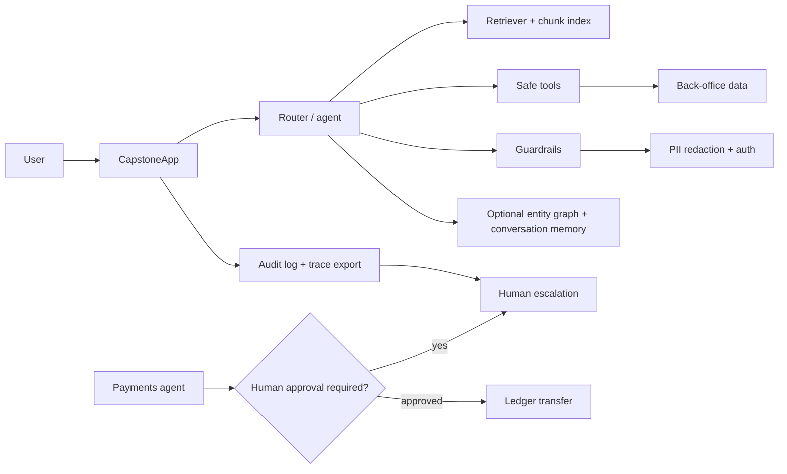

# Architecture - Meridian Support Assistant

## Context
The Meridian Support Assistant supports branch and payments teams that need fast answers about account status, fee schedules, and policy questions. People in front-line support, operations, and analyst teams use the service to answer routine questions without exposing sensitive data or bypassing control points. The system interacts with a local retrieval index, the bank's fake back-office data, and the app-level guardrails that enforce least privilege.

## Diagram

## Components and why
- Policy retrieval keeps the system grounded in Meridian bank documents instead of free-form memory.
- Safe tool wrappers validate account IDs and fee types before data access.
- A least-privilege authorization policy blocks functions such as transfer initiation for staff roles that must only read or escalate.
- A tamper-evident audit log and trace file give operations reviewers a path to confirm what actually happened.
- Graceful degradation turns outage scenarios into a human handoff instead of a crash or a leaked answer.
- The optional entity graph resolves aliases and retrieves multi-hop evidence from the same local corpus. Conversation memory preserves pinned facts, summarizes older turns, and enforces a strict token budget.
- The optional transaction orchestrator isolates retrieval from ledger operations and requires a payments-agent role. Large transfers and new beneficiaries pause for explicit human approval; approvals are idempotent and funds are checked again at execution.

## Data flow and where PII is touched
User requests flow into the app, then through the retrieval index and the policy tools. PII is redacted before it is written to logs and before it is returned in a user-facing answer. Protected values, such as account numbers and contact details, are never kept in the raw audit trail. The business data itself remains synthetic and offline.

## Failure modes and mitigations
If a tool is unavailable, the app triggers a degraded mode and routes the request to a human reviewer. If a policy document includes prompt injection, the guardrail strips the malicious sentence and keeps the safe portions of the text. If an audit entry is edited or deleted, the chain verification fails and identifies the first bad sequence number.

## Decisions and alternatives rejected
The design avoids a direct model-to-back-office path to prevent uncontrolled actions. A full RAG-only approach was rejected because the assistant also needs to validate business rules, accounts, and approval flows. A permissive policy that grants every role the same access was rejected because it contradicts Meridian's dual-control and least-privilege controls.
